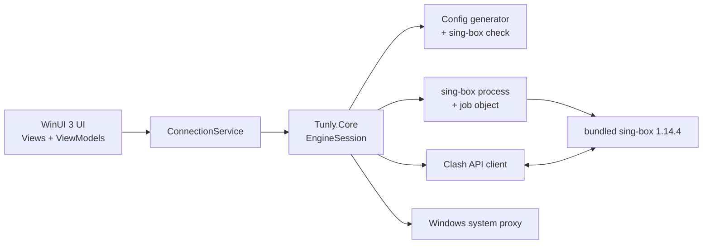
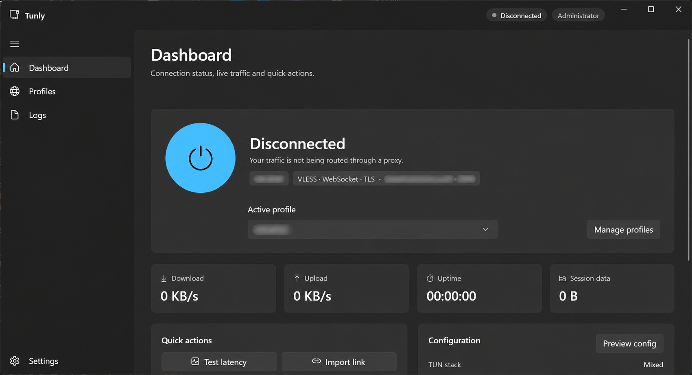
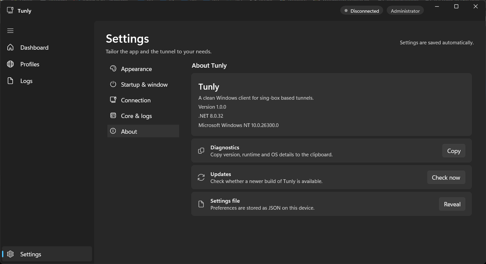

# Tunly

A native Windows client for [sing-box](https://sing-box.sagernet.org/). Import a profile,
connect, and watch live traffic and logs. The portable release bundles the core, so there
is nothing else to install.

## Features

- **Real engine** — generates a sing-box config, validates it with `sing-box check`, and runs it in a Windows job object.
- **Bundled core** — official sing-box **1.14.4** ships in `core\` with the portable and MSIX builds.
- **Profiles** — VLESS, VMess, Trojan, Shadowsocks, Hysteria2, TUIC; share links, subscriptions, and raw JSON.
- **Fast switching** — every profile is an outbound behind a selector; switching does not restart the core.
- **Live telemetry** — traffic rates and session totals from the Clash API, plus real core logs.
- **TUN + mixed proxy** — `tunly0` TUN adapter and a local SOCKS/HTTP port, with optional Windows system proxy.

## Requirements

- Windows 10 1809+ or Windows 11 (x64).
- **Administrator rights** for TUN mode.
- [.NET 8 SDK](https://dotnet.microsoft.com/download/dotnet/8.0) only when building from source.
- Source builds without the bundle need sing-box **1.12+** in Settings, on `PATH`, or via **Download latest**.

## Build and run

```powershell
dotnet build Tunly/Tunly.csproj -c Debug -p:Platform=x64
.\Tunly\bin\x64\Debug\net8.0-windows10.0.19041.0\win-x64\Tunly.exe
```

Tests:

```powershell
dotnet test Tunly.Tests/Tunly.Tests.csproj
```

## Install

### Portable (recommended — TUN works)

1. Download `Tunly-<version>-windows-x64-portable.zip` and `Install-Portable.ps1`.
2. Run PowerShell as administrator:

```powershell
powershell -ExecutionPolicy Bypass -File .\Install-Portable.ps1
```

This installs to `%LOCALAPPDATA%\Programs\Tunly` and creates Start Menu/desktop shortcuts.
The app includes the core, so no path selection is needed.

### MSIX

Download the `.msix`, the `-certificate.cer`, and `Install-MSIX.ps1`, then run the script as
administrator. The MSIX is handy for UI testing, but packaged apps start unelevated, so
**TUN mode requires the portable build**.

### Release workflow

GitHub → **Actions** → **Release (manual)** → **Run workflow**. Optionally pass a version
and mark a pre-release. It builds/tests the selected ref, bundles the pinned sing-box core,
creates a portable ZIP and a signed MSIX, and uploads a GitHub Release with checksums.

## Architecture



The WinUI layer talks to `ConnectionService`, which owns state, traffic, and errors.
`Tunly.Core` is a UI-free engine library: config generation, core discovery/version checks,
process supervision, Clash API, latency probes, and system proxy. `sing-box` runs as a
child process and owns the TUN/mixed inbounds.

## Tech stack

| Area | Choice |
|---|---|
| Runtime | .NET 8, C# 12 |
| UI | WinUI 3, Windows App SDK 2.6.4 |
| Engine | sing-box 1.12+; bundled 1.14.4 |
| Control plane | Clash API (`/traffic`, `/proxies`, `/delay`) |
| Config | `System.Text.Json` |
| Process lifetime | Win32 job object (`KILL_ON_JOB_CLOSE`) |
| Tests | xUnit (61 tests) |
| Packaging | portable ZIP, signed MSIX, GitHub Actions |

## How it works

- Each profile becomes an outbound tagged `profile:{id}`; a `proxy` selector is the final route.
- The config is written to `%LOCALAPPDATA%\Tunly\config\config.json` and checked before launch.
- `sing-box run` is started in a job object, so it cannot outlive the app.
- Live rates and profile switching use the loopback Clash API; logs stream to the Logs page and file.
- Config-affecting settings restart the core after a short debounce.
- Core resolution order: Settings path → downloaded core → bundled `core\` → `PATH`.

## Local data

| Path | Contents |
|---|---|
| `%LOCALAPPDATA%\Tunly\settings.json` | Preferences and session state |
| `%LOCALAPPDATA%\Tunly\profiles.json` | Profiles (credentials are plaintext) |
| `%LOCALAPPDATA%\Tunly\config\config.json` | Generated sing-box config |
| `%LOCALAPPDATA%\Tunly\sing-box.log` | Core log |
| `<install>\core\` | Bundled core, license, and source note |

## Troubleshooting

- **Core not found** — use the portable release, set the path in Settings, or click **Download latest**.
- **“1.12 or newer required”** — update the core.
- **TUN fails** — run as administrator; Remote Desktop sessions may block the adapter.
- **Bundled core not used** — a configured path or downloaded core takes precedence; clear the path.
- **MSIX cannot connect** — expected; use the portable install for TUN.

## Preview




## License

All rights reserved. Personal, private-use project.

The portable/MSIX release bundles the unmodified official sing-box binary under
**GPL-3.0-or-later**; see `core\LICENSE` and `core\SOURCE.txt`. Tunly's own source is not GPL.
